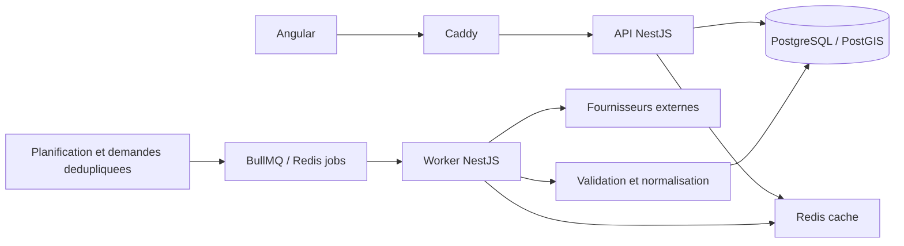

# ADR-001 - Monolithe modulaire et collecte separee

Statut : accepte le 16 novembre 2026. Decision : #6. Branche : `architecture`.
Base de reference : `8bde4fe`, refonte visuelle validee et conservee.

## Contexte

Angular, NestJS, PostgreSQL/PostGIS, Redis et BullMQ sont conserves. Le backend
possede deja des modules, mais les consultations declenchent des appels aux
fournisseurs et melangent collecte, persistance, scores et valeurs de secours.
Le worker actuel ne constitue pas encore une chaine d'ingestion operationnelle.

Le front utilise maintenant HttpClient pour l'API ; le constat initial de #6
sur le melange HttpClient/fetch precede la refonte visuelle. Les 55 tests
Playwright existants servent de filet de regression, pas de validation du metier.

## Options et decision

| Option | Avantages | Couts et limites |
| --- | --- | --- |
| Tout dans le processus API | Exploitation minimale | Les collectes concurrencent les requetes et partagent leurs pannes |
| Monolithe modulaire, API et worker separes | Code partage, isolation des collectes, dimensionnement distinct | Un processus et une file a superviser en plus |
| Microservices | Deploiement et autonomie par domaine | Reseau, contrats distribues, coherence et exploitation plus complexes |

Retenir la deuxieme option. Le backend garde une base de code, une base de
donnees et une image Docker, avec deux points d'entree et deux conteneurs.
Le worker importe les services applicatifs utiles, pas le serveur HTTP.
Une extraction en microservice exigera un besoin mesure de charge ou d'autonomie.
Pas de Kubernetes, Kafka, event sourcing ni remplacement systematique par un ORM.

Le cout d'exploitation depend du territoire, des quotas et du volume de #3.
Un hote Compose est la cible du pilote, sans promesse de haute disponibilite.
La consultation gratuite n'implique pas une infrastructure sans cout.

## Responsabilites

| Module | Responsabilite et donnees possedees |
| --- | --- |
| Catalogue | Plages, identifiants sources, geometries, categorie d'eau, equipements |
| Conditions | Mesures, previsions, historiques et derniers etats normalises |
| Securite | Alertes et drapeaux officiels, provenance et validite |
| Communaute | Signalements, historique, consensus, expiration et moderation |
| Recommandations | Calculs purs, regles versionnees, explications et couverture |
| Identite | Identites, roles et favoris selon le perimetre V1 |
| Integrations | Adaptateurs fournisseurs, planification, quotas, executions et reprises |

Organisation interne : controleur/contrat -> service applicatif -> regles metier
et interfaces de persistance. Les adaptateurs SQL, HTTP et BullMQ restent en
infrastructure. Chaque module possede ses ecritures ; les lectures transversales
explicitement dediees a la recherche peuvent utiliser des jointures PostGIS.
Ni HTTP, ni Redis, ni SQL dans les regles de calcul des scores.

## Flux cible

Les consultations courantes lisent les donnees enregistrees sans appel fournisseur
bloquant. Une zone inconnue peut demander une collecte asynchrone dedupliquee,
mais retourne entre-temps un etat absent ou perime explicite. Les contributions
passent par validation et controle d'acces avant persistance.

Les taches ont une cle d'idempotence, des delais maximaux, une concurrence
bornee, des reprises et une visibilite sur leurs echecs. La cadence depend du
produit et des quotas ; l'actualisation du navigateur ne transforme pas une
prevision en observation temps reel. Le Redis des jobs est persistant et sans
eviction, distinct du cache jetable en production.

## Contrats et frontend

OpenAPI definit les contrats externes et genere le client Angular. La validation
des entrees reste obligatoire a l'execution. Une mesure contient valeur nullable,
unite, fournisseur/produit, nature (observation, prevision, contribution), date
de validite, date de collecte et fraicheur. Les dates sont normalisees en UTC.
Les equipements distinguent presence connue, absence connue et information inconnue.

Les valeurs absentes ne deviennent ni zero, ni une temperature par defaut.
Les donnees de demonstration sont isolees. Chaque source reste tracable ; une
fusion numerique exige des donnees comparables et une methode versionnee.
Les drapeaux, alertes et classements sanitaires ne sont jamais moyennes.
Un consensus communautaire ne remplace pas une interdiction officielle.

Filtres, tri et pagination stable sont traites au serveur. Les scores indiquent
la couverture des entrees et deviennent indisponibles si elle est insuffisante.

Angular est organise par fonctionnalite, avec facades d'acces aux donnees et
etat Signals/RxJS. Les composants visuels restent inchanges. Le monorepo cible
utilise npm workspaces, avec `apps/web`, `apps/api`, `packages/api-client`,
`infra` et `migrations`. Le regroupement des lockfiles attend le lot contrats ;
le premier lot conserve les deux lockfiles actuels pour limiter les changements.

## Migration et ordre des lots

1. #9 / #10 : versions fixes, installations propres, CI, tests isoles,
   protection provisoire des routes d'administration et verification de restauration.
2. #7 / #8 : contrats, client genere, migrations additives et seeds isoles.
3. #13 / #14 / #19 : catalogue, classification et equipements fiables, recherche serveur.
4. #15 / #11 / #12 : worker, collecte reelle, normalisation et suppression des simulations publiques.
5. #16 / #17 / #18 : fournisseurs officiels selon acces, licence et couverture.
6. #21 / #22 / #23 / #25 : scores, securite, signalements et choix des sources.
7. Mise en production : HTTPS, configuration, sante, supervision, restauration et charge pilote.

Chaque lot livre une tranche testable et adapte le front concerne sans refaire
son apparence. Les contrats actuels sont conserves via des adaptateurs pendant
la transition. Aucun changement de stockage avant sauvegarde et test de restauration.

Strategie : ajouter le schema compatible, migrer progressivement avec reprise,
basculer les lectures, puis retirer l'ancien schema dans un lot ulterieur.
Conserver UUID, identifiants OSM et relations existantes. Verifier comptes et
integrite avant/apres. Un retour a l'image precedente doit fonctionner pendant
la transition ; ne pas compter sur un downgrade SQL destructeur ou la suppression
d'un volume. Les changements de lecture importants peuvent etre actives par configuration.

## Acceptation et suivi

- Aucun appel fournisseur bloquant sur une consultation courante.
- Rejouer une collecte ne cree pas de doublons ; une panne fournisseur conserve
  un etat perime explicite ou une absence, jamais une valeur inventee.
- Chaque mesure expose sa provenance et sa validite ; les filtres portent sur
  le catalogue complet avant pagination.
- Les tests UI existants restent verts ; tests metier, contrats et integration
  PostGIS/Redis sont ajoutes au fil des lots.
- Installation sur base neuve, migration d'une base existante et restauration
  sont verifiees avant la mise en production.
- Objectif propose : lectures courantes au p95 inferieur a 500 ms, avec charge
  et jeu de donnees du pilote a definir. Ce resultat n'est pas encore mesure.
- Superviser latence HTTP, retard des collectes, echecs de jobs et quotas fournisseurs.

#3 reste ouvert : territoire, usages, comptes, couverture et budget restent a
preciser avant les lots fonctionnels. Ces choix ne bloquent pas les garde-fous.
La decision #6 est acceptee ; elle ne signifie pas que l'architecture est migree.
Les issues #7, #8 et #15 suivent l'implementation, #9 et #10 le premier lot.

## References techniques

- [NestJS : application sans serveur HTTP](https://docs.nestjs.com/standalone-applications)
- [BullMQ : exigences de production](https://docs.bullmq.io/guide/going-to-production)
- [PostGIS : recherches de proximite](https://postgis.net/docs/ST_DWithin.html)
